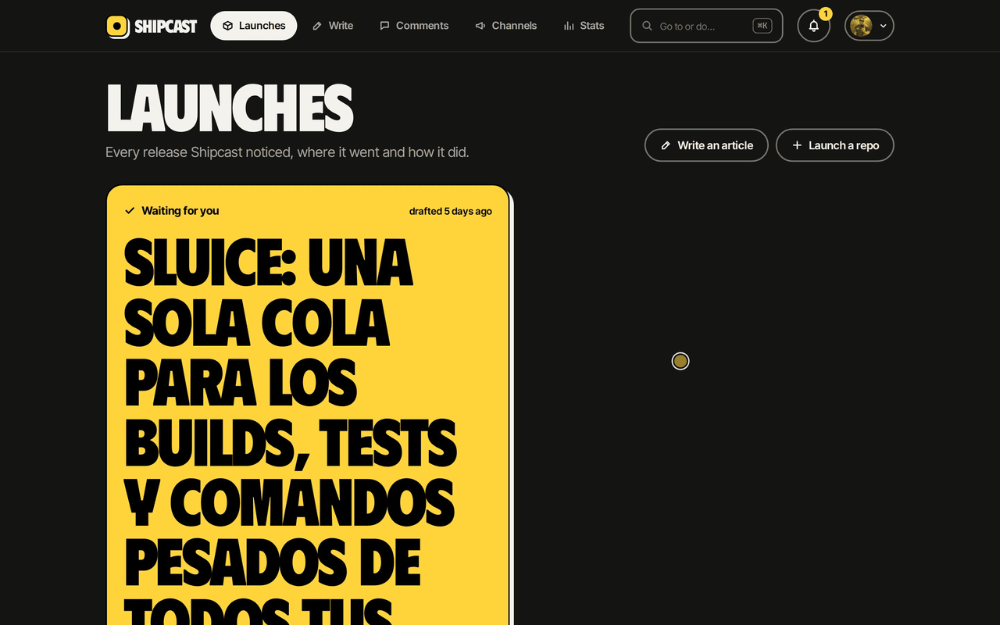

<p align="center">
  
</p>
<h1 align="center">Shipcast</h1>
<p align="center"><strong>Launch your GitHub projects without writing the same announcement ten times.</strong></p>
<p align="center">
  <a href="https://josegarrido.dev/en/projects/shipcast/?utm_source=github&utm_medium=referral&utm_campaign=shipcast-readme">Website</a> ·
  <a href="docs/getting-started.md">Docs</a> ·
  <a href="https://josegarrido.dev/en/shipcast-launch-your-github-projects/?utm_source=github&utm_medium=referral&utm_campaign=shipcast-readme">Launch article</a>
</p>
<p align="center">
  <a href="https://github.com/yeyo11/shipcast/actions/workflows/ci.yml"></a>
  <a href="https://github.com/yeyo11/shipcast/releases"></a>
  <a href="https://www.npmjs.com/package/@yeyo11/shipcast"></a>
  <a href="LICENSE"></a>
</p>

You publish a release. Shipcast reads the project's code at that tag, not just its README, and writes
the blog article and a post for each channel you use, saying only what the code does. It all
arrives as one pull request in your blog's repo; merging it publishes each piece once: the article
on your blog, its copies on dev.to and Hashnode, and the posts on Bluesky, Mastodon, LinkedIn, Reddit
and the other channels you turn on. Run it as a GitHub Action with your own Anthropic or OpenAI key,
or self-host it with an app to review, schedule and measure every launch.

I built it to launch my own projects: claudio, Sluice and Shipcast itself went out through it.



**Is it for you?**

- **You need** a GitHub repo with releases and a launches repo: an Astro blog, deployed, that reads
  Shipcast's articles ([the contract](docs/launches-repo.md)). Every post links the article. No blog
  yet? Start from [the template](https://github.com/yeyo11/shipcast-blog), which already reads them.
- **GitHub Action**: an Anthropic or OpenAI key (or an OpenAI-compatible server), a fine-grained GitHub
  token and Node 24 to run `npx` once. Nothing to host.
- **Self-hosted**: Node 24 and Docker (for Postgres), and claudio, an Anthropic or OpenAI key or an
  OpenAI-compatible server. It adds the app (review, scheduling, stats, replies to comments) and
  LinkedIn, Reddit, Threads and YouTube.
- **Optional**: every channel. Turn on the ones you have accounts for; the rest stay `off`.

## Channels

| Channel | What Shipcast does | In the Action |
| --- | --- | --- |
| Blog | Commits the article in each language; the merge publishes it | yes |
| dev.to, Hashnode | Republish the English article with the blog as canonical URL | yes |
| Bluesky, Mastodon | A post with a link card or image | yes |
| Telegram, Discord | A post to your channel, an embed through a webhook | yes |
| GitHub Discussions | A discussion in the launched repo, linking the article | yes |
| Instagram | A carousel (cover, demo video, features, closing), a story and a comment | with secrets added by hand |
| Newsletter (Brevo) | One issue per language, sent to your lists | with secrets added by hand |
| YouTube | A Short and a horizontal video per launch, from the demo, screenshots and cover | self-hosted |
| Threads | A post with the launch image, linking the article | self-hosted |
| LinkedIn | A post on your personal profile with the article as its link card | self-hosted |
| Reddit | One text post per subreddit, linking the article, from your account (your Reddit app needs Reddit's API approval) | self-hosted |

The networks marked self-hosted sign in through the app (OAuth), which the Action does not have.
Shipcast only lists networks it publishes on itself: Hacker News and Product Hunt have no API to post
through, and X is not supported.

## Quick start

**GitHub Action.** In your project's repo, with Node 24 (the command runs the Shipcast CLI from npm):

```bash
npx @yeyo11/shipcast init
```

It writes `.github/launch.yml` and a launch workflow for the
[Shipcast Launch](https://github.com/yeyo11/shipcast-action) Action in the project, `brand.yml` and a
publish workflow for your launches repo, and prints every secret to set with the link to get it. Then
publish a release. The whole walk-through: [docs/getting-started.md](docs/getting-started.md).

**Self-hosted.** On a machine of yours, with git, Node 24 (with corepack) and Docker:

```bash
curl -fsSL https://raw.githubusercontent.com/yeyo11/shipcast/main/scripts/install.sh | sh
cd shipcast && pnpm app          # then finish in the app's onboarding
```

The installer clones Shipcast into `./shipcast` and runs `shipcast init`, which writes the bootstrap
`.env`, starts Postgres and creates your GitHub App from a manifest; the app's onboarding sets the
launches repo, the AI provider and the channels. It runs `corepack enable`, which writes beside Node:
with a Node installed system-wide, run `sudo corepack enable` once first. See
[docs/install.md](docs/install.md).

## How it works

1. **Opt in per repo.** A `.github/launch.yml` turns launches on and sets a mode for each channel:
   `approval` (published when you approve), `auto` or `off`.

   ```yaml
   # .github/launch.yml
   enabled: true
   brand: personal
   publishing:
     blog: approval
     devto: approval
     bluesky: approval
     instagram: approval
     reddit: approval     # one post per subreddit below
   reddit:
     subreddits: [selfhosted]
   assets:
     demo: docs/demo.gif
   ```

2. **Trigger.** Publish a release: in the Action, the release event starts the launch; self-hosted,
   the GitHub App's webhook does (or polling, when the app has no public address). You can also pick
   a repo and a release in the app. A pre-flight check first makes sure there is a release, a valid
   `launch.yml`, a licence, a README and the demo.
3. **Analyse.** The AI you choose (Anthropic, OpenAI or an OpenAI-compatible server, or claudio
   self-hosted) reads the repository at the release's tag, with its release notes and what was
   announced before, and separates what is implemented from what is only planned or claimed by the
   docs; only the implemented part is presented as working.
4. **Generate.** One structured content pack per launch: the article in each language, a piece written
   for each channel within its limits, the launch image, the Instagram carousel and story, and a cover
   in your blog's style when the project has none.
5. **Approve.** The drafts arrive as a pull request in your launches repo, which is also your blog's
   source. Read and edit every piece in the app or on GitHub; approving merges it and publishes. Or
   skip the review and publish straight away.
6. **Publish and measure.** Each channel is published once, never twice; a failure is retried or left
   for you to retry. Visits by channel, search, stars and traffic, and each post's numbers end up on
   the launch's page. With Telegram connected, you hear when drafts wait and when a launch is out.

You can also **write an article** in the app, in your own words: Shipcast translates it, writes each
channel's piece and publishes it the same way.

## The app

`pnpm app` serves Shipcast's web app: on this machine at first (`127.0.0.1:8744`, with a one-time
sign-in link), or on an `https://` address of yours, with its own Let's Encrypt certificate or behind
your reverse proxy, where you sign in with GitHub.

- **Launches**: every launch, where it went, what waits for you, and its numbers; edit, delete or
  schedule what went out, where the network allows it.
- **Stats**: charts by channel, account, launch and dates, a ranking per network, followers over time.
- **Comments**: the replies under your posts, each with a reply drafted from the code, sent when you
  approve it.
- **Channels**: the accounts of each network, several per brand, each credential checked; secrets in
  your operating system's keychain.
- **Launch a repo** and **Write**, with a writing assistant beside every draft.
- **Settings**: the AI providers and prompts, automation (polling or GitHub webhooks), and API tokens
  for the REST API and the MCP server ([docs/mcp.md](docs/mcp.md)).

The AI provider is the Anthropic API, an OpenAI-compatible server or
[claudio](https://github.com/yeyo11/claudio), which runs Claude Code as a service. PostgreSQL holds
the launch registry: `docker-compose.yml` here starts it, and claudio if you use it
(`docker compose --profile claudio up -d`); tests need no database. See
[docs/web-app.md](docs/web-app.md).

## Built with

TypeScript on Node 24 in a pnpm monorepo: `packages/schema` (Zod), `packages/engine` (the registry on
PostgreSQL through Drizzle, detection, generation, publishing), `packages/connectors` (one module per network over
`fetch`, no SDKs), `packages/assets` (Satori and resvg), `packages/runtime` (accounts and keychain),
`apps/cli` and `apps/web` (TanStack Start). The design, with every decision and the reasoning behind
it, is in [docs/plans/shipcast.md](docs/plans/shipcast.md); where it stands, in
[docs/status.md](docs/status.md).

## Contributing

Ideas and bug reports are welcome as [issues](https://github.com/yeyo11/shipcast/issues). Until the
MVP the code moves fast and straight on `main`, so please open an issue before a pull request; see
[CONTRIBUTING.md](CONTRIBUTING.md).

## Support

If Shipcast is useful to you, a star helps other developers find it.

[](https://buymeacoffee.com/yeyo11)

## License

[MIT](LICENSE) © Jose Antonio Garrido
