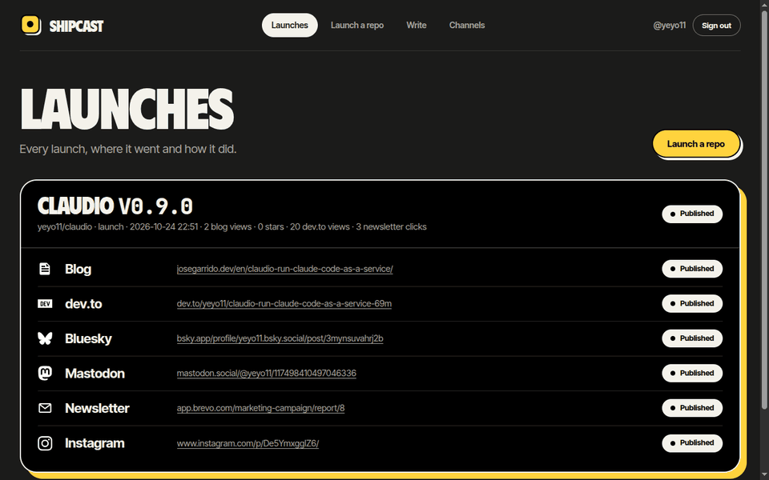

# Shipcast

**Ship** + broad**cast**: launch your GitHub projects without writing the same announcement ten times.

[](https://github.com/yeyo11/shipcast/actions/workflows/ci.yml)
[](LICENSE)

[](https://buymeacoffee.com/yeyo11)

You publish a release. Shipcast reads the project's **code**, not just its README, writes a launch
piece for every channel, and publishes each one once you approve it: the article on your blog in
English and Spanish, canonical copies on dev.to and Hashnode, posts on Bluesky, Mastodon, Threads,
LinkedIn, Telegram and Discord, one post per subreddit on Reddit, an announcement in the repo's GitHub
Discussions, an Instagram carousel with its story and a newsletter issue. Then it reads back how each
channel did.



> [!NOTE]
> Shipcast is **alpha**, built for and used by its author: it launched
> [claudio](https://github.com/yeyo11/claudio) v0.9.0 and its own v0.1.0. It runs on your own machine
> with your own accounts, or in GitHub Actions; [installing it](#what-you-need) takes one command and
> the app's onboarding.

Read the launch article, written and published by Shipcast itself:
[Shipcast: launch your GitHub projects without writing the announcement ten times](https://josegarrido.dev/en/shipcast-launch-your-github-projects/)
([en español](https://josegarrido.dev/es/shipcast-lanza-tus-proyectos-de-github/)), and every launch
on [the project's page](https://josegarrido.dev/en/projects/shipcast/) of the author's blog.

## How it works

1. **Opt in per repo.** A `.github/launch.yml` turns launches on and sets a mode for each channel:
   `approval` (published when you approve), `auto` or `off`.

   ```yaml
   # .github/launch.yml
   enabled: true
   brand: personal
   publishing:
     blog: approval
     devto: approval
     bluesky: approval
     instagram: approval
     reddit: approval     # one post per subreddit below
   reddit:
     subreddits: [selfhosted]
   assets:
     demo: docs/demo.gif
   ```

2. **Trigger.** Publish a release (the engine polls your public GitHub events, no webhooks), or pick a
   repo and a release in the app. A pre-flight check first makes sure there is a release, a valid
   `launch.yml`, a license, a README and the demo.
3. **Analyse.** Claude reads the repository and separates what is implemented from what is only
   planned or claimed by the docs; only the implemented part is presented as working.
4. **Generate.** One structured content pack per launch: the article in each language, a piece written
   for each channel within its limits, the launch image, the Instagram carousel and story, and a cover
   in your blog's style when the project has none.
5. **Approve.** The drafts arrive as a pull request in your launches repo, which is also your blog's
   source. Read and edit every piece in the app or on GitHub; approving merges it and publishes. Or
   skip the review and publish straight away.
6. **Publish and measure.** Each channel is published once, never twice; a failure is retried or left
   for you to retry. Visits by channel, search, stars and traffic, and each post's numbers end up on
   the launch's page. With Telegram connected, you hear when drafts wait and when a launch is out.

You can also **write an article** in the app, in your own words: Shipcast translates it, writes each
channel's piece and publishes it the same way.

## The app

`pnpm app` serves Shipcast's web app on a domain of yours reachable only over your
[Tailscale](https://tailscale.com) network, with its own Let's Encrypt certificate:

- **Launches**: every launch, where it went, what is waiting for you, and its numbers; a launch's
  page edits or deletes what went out, where the network allows it, and schedules what has not.
- **Stats**: charts by channel, account, launch and dates, a ranking normalised per network, and
  each account's followers over time.
- **Comments**: the replies under your posts, each with a reply drafted from the project's code,
  sent when you approve it.
- **Channels**: every network, the accounts connected to each (per brand, several per network), what
  Shipcast may do with them, a check of each credential, and OAuth where the network has it. Secrets
  live in your operating system's keychain.
- **Launch a repo** and **Write**, with a writing assistant beside every draft and the choice to
  review first or publish directly.
- **Settings**: the AI providers and prompts, automation (polling or GitHub webhooks), and API tokens
  for the REST API and the MCP server ([docs/mcp.md](docs/mcp.md)).

Sign-in is with GitHub, limited to the logins you allow. See [docs/web-app.md](docs/web-app.md).

## What you need

- Node 24 and pnpm; on Linux, `libsecret-tools` for the keychain; ffmpeg for the demo video.
- [claudio](https://github.com/yeyo11/claudio), which runs Claude Code as a service, as the AI provider,
  and PostgreSQL for the launch registry (`docker-compose.yml` here starts both; tests need neither).
- A launches repo with an Astro blog that accepts Shipcast's articles
  ([docs/launches-repo.md](docs/launches-repo.md) describes the contract), and its `brand.yml`.
- An account on each network you want, connected from the app or listed in `.env`
  ([.env.example](.env.example)).

Install in one command (it clones Shipcast, installs it and runs `shipcast init`, which writes the
bootstrap `.env`, starts Postgres and creates your GitHub App from a manifest):

```bash
curl -fsSL https://raw.githubusercontent.com/yeyo11/shipcast/main/scripts/install.sh | sh
cd shipcast && pnpm app          # then finish in the app's onboarding
```

Or by hand, in a clone: `pnpm install`, then `pnpm shipcast init`. Everything else (the launches
repo, the AI provider, the channels) is set in the app's onboarding. See
[docs/install.md](docs/install.md).

**Without a machine of your own**, Shipcast runs in GitHub Actions: `shipcast ci` with the composite
action at this repo's root and the workflows in `templates/`
([docs/decisions/action-mode.md](docs/decisions/action-mode.md)).

An install from before Postgres keeps its registry in `data/shipcast.db`: stop the app and the CLI,
start Postgres, then `pnpm sqlite-to-postgres` copies every row into the database at
`SHIPCAST_DATABASE_URL` ([docs/decisions/postgres.md](docs/decisions/postgres.md)).

## Channels

| Channel | What Shipcast does |
| --- | --- |
| Blog | Commits the article in each language; the merge publishes it |
| dev.to, Hashnode | Republish the English article with the blog as canonical URL |
| Bluesky, Mastodon | A post with a link card or image |
| Instagram | A carousel (cover, demo video, features, closing), a story and a comment |
| Newsletter (Brevo) | One issue per language, sent to your lists |
| Threads | A post with the launch image, linking the article |
| LinkedIn | A post on your personal profile with the article as its link card |
| Reddit | One text post per subreddit, linking the article, from your account (your Reddit app needs Reddit's API approval) |
| GitHub Discussions | A discussion in the launched repo, linking the article |
| Telegram, Discord | A post to your channel, an embed through a webhook |

Shipcast only lists networks it publishes on itself: Hacker News and Product Hunt have no API to post
through, and X is not supported.

## Built with

TypeScript on Node 24 in a pnpm monorepo: `packages/schema` (Zod), `packages/engine` (the registry on
PostgreSQL through Drizzle, detection, generation, publishing), `packages/connectors` (one module per network over
`fetch`, no SDKs), `packages/assets` (Satori and resvg), `packages/runtime` (accounts and keychain),
`apps/cli` and `apps/web` (TanStack Start). The design, with every decision and the reasoning behind
it, is in [docs/plans/shipcast.md](docs/plans/shipcast.md); where it stands, in
[docs/status.md](docs/status.md).

## Contributing

Ideas and bug reports are welcome as [issues](https://github.com/yeyo11/shipcast/issues). Until the
MVP the code moves fast and straight on `main`, so please open an issue before a pull request; see
[CONTRIBUTING.md](CONTRIBUTING.md).

## License

[MIT](LICENSE) © Jose Antonio Garrido
